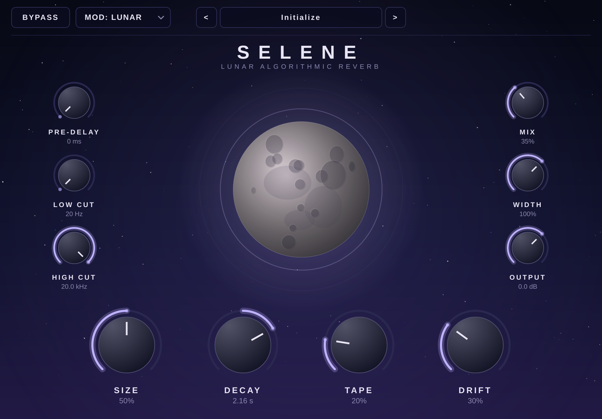

# Selene — lunar algorithmic reverb



A lush, modulated algorithmic reverb plugin (AU / VST3 / Standalone) inspired by the
"big moon reverb" style of plugins: four macro controls, an animated moon that reacts
to the sound, and a reverse-style **inverted decay**.

## Controls

| Control | What it does |
|---|---|
| **Size** | Scale of the space, from a small room to a vast crater. |
| **Decay** | Tail length (250 ms – 30 s). Turn it **left of centre** to invert the tail into a reverse-style swell that builds up instead of dying away. |
| **Tape** | Saturation and high-frequency roll-off inside the tail for warmth. |
| **Drift** | Pitch drift / movement in the tail. Character set by the **MOD** menu. |
| **MOD** | `Lunar` smooth chorus · `Drift` random lo-fi wander · `Warble` tape wow & flutter. |
| Pre-Delay | 0 – 500 ms before the tail starts. |
| Low Cut / High Cut | Filters on the reverb only. |
| Mix | Dry/wet (equal-power). |
| Width | Stereo width of the reverb (0 – 150%). |
| Output | Output gain. |
| Bypass | Click-free bypass (also mapped to the DAW's bypass). |

12 factory presets (Moonrise Vocal, Lunar Pad, Tape Haze, Inverted Tide, Endless Night…),
browsable with the `<` `>` arrows or by clicking the preset name. Double-click any knob to reset it.

## Installing in Logic Pro (macOS)

1. Open the repo's **Actions** tab → latest **Build** run → download **Selene-macOS**.
2. Unzip, then copy:
   - `Selene.component` → `~/Library/Audio/Plug-Ins/Components/`
   - `Selene.vst3` → `~/Library/Audio/Plug-Ins/VST3/` (for other DAWs)
3. The build is not notarised, so remove the download quarantine once in Terminal:
   ```sh
   xattr -dr com.apple.quarantine ~/Library/Audio/Plug-Ins/Components/Selene.component
   ```
4. Restart Logic. It appears under **Audio Units → Agelin Audio → Selene**.
   If it doesn't, open *Logic → Settings → Plug-in Manager*, select Selene and click *Reset & Rescan Selection*.

## Building yourself

```sh
cmake -S . -B build -DCMAKE_BUILD_TYPE=Release        # fetches JUCE 8 automatically
cmake --build build --config Release --target Selene_AU Selene_VST3 Selene_Standalone
```

On macOS use `-G Xcode` (and `-DCMAKE_OSX_ARCHITECTURES="arm64;x86_64"` for a universal binary).

## Tests

```sh
g++ -O2 -std=c++17 -I Source tests/render_test.cpp -o render_test && ./render_test .
```

Checks stability at extreme settings, that Decay hits its target RT60, that inverted decay
swells, and wet/dry loudness; writes impulse responses and demo renders as WAV files.

## How it works

`Source/dsp/MoonReverb.h` — pre-delay → 4-stage allpass input diffusion per channel →
(optional rising multi-tap "swell" for inverted decay) → 8-line feedback delay network with a
Hadamard mixing matrix, per-line modulated delay times (Drift), and tape saturation + damping
in the loop (Tape). Feedback gains are computed from the target RT60 so Decay is accurate at
every Size.

Built with [JUCE](https://juce.com) 8 (GPLv3 / commercial licence — check JUCE's terms before
selling the plugin).
